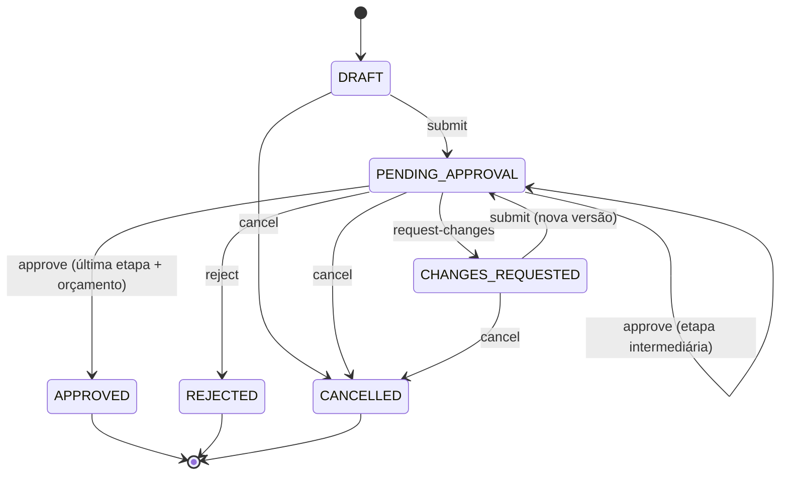

# Programa de Recrutamento - Kingspan

## Teste Técnico — Desenvolvedor(a) Fullstack Pleno

> **Stack:** Java (Spring Boot) ou Node.js (NestJS / Express / Fastify) + React (Next.js é aceito) ou Angular
> **Prazo:** 7 dias corridos a partir do e-mail de convite; a data e o horário limite estão no convite (esforço estimado: 20–25 h, incluindo o vídeo)
> **Uso de IA:** permitido e esperado, **com registro obrigatório** (ver [seção 9](#9-uso-de-ia--permitido-com-registro-obrigatório))
> **Entrega:** fork público no GitHub + **vídeo de 15 a 25 min** seguindo o fluxo operacional do sistema e explicando regras de negócio, detalhes técnicos, validações, decisões de arquitetura e contingências (ver [seção 8.1](#81-vídeo-de-apresentação-obrigatório))
> **Branch deste enunciado:** `teste-pleno`. Ao criar o fork, **desmarque** *"Copy the `main` branch only"* (ver [seção 8](#8-instruções-de-entrega))

---

## Sumário

1. [Contexto do Desafio](#1-contexto-do-desafio)
2. [Requisitos Funcionais](#2-requisitos-funcionais)
3. [Especificação da API REST](#3-especificação-da-api-rest)
4. [Regras de Negócio — Máquina de Estados](#4-regras-de-negócio--máquina-de-estados)
5. [Requisitos Não Funcionais (obrigatórios)](#5-requisitos-não-funcionais-obrigatórios)
6. [Diferenciais](#6-diferenciais)
7. [Critérios de Avaliação](#7-critérios-de-avaliação)
8. [Instruções de Entrega](#8-instruções-de-entrega)
9. [Uso de IA — permitido, com registro obrigatório](#9-uso-de-ia--permitido-com-registro-obrigatório)
10. [⚠️ Regras do Repositório (eliminatórias)](#️-10-regras-do-repositório-eliminatórias)
11. [Dúvidas](#11-dúvidas)

---

## 1. Contexto do Desafio

Você vai construir o módulo de **solicitações de compra** de uma indústria com vários **centros de custo**. Cada centro de custo tem um **orçamento mensal**. As solicitações passam por uma **cadeia de aprovações em sequência**, que depende do valor e da categoria da compra. A auditoria interna exige **rastreabilidade completa**: quem fez o quê, quando, em qual versão da solicitação.

No dia a dia, dois aprovadores podem clicar ao mesmo tempo, o usuário pode reenviar o mesmo formulário duas vezes e o orçamento do mês pode acabar no meio do fluxo. **O sistema precisa continuar correto nessas situações.** É isso que diferencia esta vaga de uma vaga júnior.

**Objetivo:** uma API REST com regras de domínio bem isoladas e testadas, consistência transacional e uma interface web que conduza cada papel pelo fluxo sem duplicar as regras do back-end.

> O teste é de **nivelamento**: a nota indica sua senioridade e ajuda a montar seu plano de entrada. Apenas as regras de integridade da [seção 10](#️-10-regras-do-repositório-eliminatórias) são eliminatórias.

### 1.1 Papéis de usuário

| Papel | Descrição |
|-------|-----------|
| `SOLICITANTE` | Cria, edita (quando permitido), submete e cancela as **próprias** solicitações. Não aprova |
| `APROVADOR` | Tudo o que o solicitante faz e, além disso, aprova, rejeita ou devolve para ajuste solicitações do **seu centro de custo**, conforme o seu nível (`approverLevel`) |
| `ADMIN` | Tudo o que os outros papéis fazem; gerencia usuários, centros de custo e orçamentos; vê tudo; é o único que aprova a etapa `ADMIN` |

- **Qualquer papel pode criar solicitações.** É por isso que a segregação de funções (2.3) importa: um aprovador ou admin nunca aprova o que ele mesmo pediu.
- Todo usuário pertence a **um centro de custo** (`costCenterId`). O `ADMIN` pode ser global.
- Todo `APROVADOR` tem `approverLevel`: `NIVEL_1` ou `NIVEL_2`. Um `NIVEL_2` também pode aprovar etapas `NIVEL_1`.
- O cadastro público (`/auth/register`) cria **apenas** `SOLICITANTE`. Outros papéis são criados por um `ADMIN`.

### 1.2 Conceitos do domínio (a modelagem é sua)

Você decide a modelagem, mas o sistema precisa representar pelo menos: **usuário**, **centro de custo**, **orçamento mensal** do centro de custo, **solicitação** com **itens** e **versões**, **etapas de aprovação** e **histórico de eventos**. As decisões de modelagem devem ser justificadas em ADR (ver 5.5).

---

## 2. Requisitos Funcionais

### 2.1 Autenticação e usuários

- Login que retorna um **JWT de curta duração** (ex.: 15 min). As claims mínimas são `sub`, `role`, `costCenterId` e `approverLevel` (quando houver)
- `GET /auth/me` com os dados do usuário logado
- Senhas guardadas com hash forte (bcrypt/argon2). Nunca devolver senha ou hash em nenhuma resposta
- `ADMIN` cria e edita usuários de qualquer papel e nível

### 2.2 Solicitações de compra

- Campos: `title`, `description`, `category`, `costCenterId` (padrão = o do solicitante), `neededBy` (data opcional, que precisa ser futura) e `items[]` (`description`, `quantity` inteiro > 0, `unitPrice` > 0)
- `category` é um enum: `EQUIPMENT | SERVICES | SUPPLIES | TRAVEL | SOFTWARE | OTHER`
- O **valor total é calculado no back-end**: cada item = `quantity × unitPrice`, arredondado para 2 casas (HALF_UP); o total é a soma dos itens. Moeda: BRL. O valor enviado pelo cliente é ignorado
- A solicitação nasce como `DRAFT`. Ela só pode ser editada em `DRAFT` ou `CHANGES_REQUESTED`, e só pelo dono
- Listagem com paginação, ordenação e filtros: `status`, `category`, `costCenterId`, `createdFrom`, `createdTo` (outros filtros são diferenciais)
- Visibilidade: o `SOLICITANTE` vê as próprias solicitações; o `APROVADOR` vê as do seu centro de custo; o `ADMIN` vê todas. **Rascunhos (`DRAFT`) só são visíveis para o dono**

### 2.3 Cadeia de aprovação

Ao **submeter**, o sistema monta a cadeia de etapas daquela versão da solicitação. As etapas são aprovadas **em ordem**:

| Valor total | Etapas (em ordem) |
|---|---|
| Até R$ 1.000,00 | `NIVEL_1` |
| De R$ 1.000,01 a R$ 10.000,00 | `NIVEL_1` → `NIVEL_2` |
| Acima de R$ 10.000,00 | `NIVEL_1` → `NIVEL_2` → `ADMIN` |

Regras adicionais:

1. **Categoria `SOFTWARE`**: sempre termina com uma etapa `ADMIN` (licenciamento e segurança), mesmo abaixo de R$ 10.000,00. A etapa `ADMIN` nunca aparece duplicada.
2. **Quem pode aprovar uma etapa:**
   - `NIVEL_1`: `APROVADOR` (`NIVEL_1` ou `NIVEL_2`) do mesmo centro de custo, ou `ADMIN`
   - `NIVEL_2`: `APROVADOR` `NIVEL_2` do mesmo centro de custo, ou `ADMIN`
   - `ADMIN`: somente `ADMIN`
3. **Segregação de funções:** ninguém aprova a própria solicitação, e a **mesma pessoa não aprova duas etapas** da mesma versão.
4. **Comentários:** opcional ao aprovar; **obrigatório** (mínimo de 10 caracteres) ao rejeitar ou devolver para ajuste.
5. **Orçamento:** a **aprovação da última etapa** consome o valor do orçamento do centro de custo no **mês de competência**, que é o mês da submissão **da versão atual** (fuso `America/Sao_Paulo`; um reenvio em outro mês muda a competência). Mês sem orçamento cadastrado tem saldo zero. Se o saldo for insuficiente, a aprovação falha com `422 BUDGET_EXCEEDED` e a solicitação continua pendente. **O saldo nunca pode ficar negativo**, nem com aprovações simultâneas:
   - duas aprovações da **mesma etapa da mesma solicitação** ao mesmo tempo → uma sucede, a outra recebe `409`;
   - aprovações finais de **solicitações diferentes** disputando o mesmo saldo → as que cabem no saldo são aprovadas, a que não cabe recebe `422 BUDGET_EXCEEDED`.
6. **Devolução para ajuste:** gera `CHANGES_REQUESTED`. O dono edita e reenvia. O reenvio cria uma **nova versão** (v2, v3…), e a versão anterior fica **imutável** e consultável. A cadeia é **recalculada do zero**, e as aprovações da versão anterior não contam.
7. **Sem aprovador elegível:** se ninguém puder aprovar a etapa atual (ex.: a etapa é `ADMIN` e o único admin é o dono da solicitação), ela continua pendente na caixa de aprovação. Isso não é erro. Por isso o seed tem dois `ADMIN` (5.4).

### 2.4 Caixa de aprovação

- `GET /approvals/inbox` lista as solicitações cuja **etapa atual** o usuário logado pode aprovar **agora**, já aplicando centro de custo, nível e segregação de funções.

### 2.5 Histórico e auditoria

- Cada ação gera um evento **append-only** (nunca é alterado nem apagado) com: ator, papel do ator, ação, status de origem e de destino, etapa, versão, comentário, data/hora (UTC) e o `X-Request-Id` da requisição.
- O histórico é consultável por solicitação.

### 2.6 Dashboard

- Totais por status, no escopo do papel (o solicitante vê os próprios; o aprovador, os do centro de custo; o admin, tudo)
- Orçamento do **mês corrente** por centro de custo: **orçado, consumido e disponível**

### 2.7 Interface web (front-end)

- Login, rotas protegidas por papel e tratamento de sessão expirada (`401` → login, voltando à rota de origem depois)
- Dashboard (2.6)
- Listagem com filtros, ordenação e paginação **no servidor**, refletidos na URL (link compartilhável)
- Caixa de aprovação (2.4)
- Formulário de criação e edição com itens dinâmicos e total exibido em tempo real (só para exibição: quem calcula é o back-end) e validação com os erros do servidor mapeados para cada campo
- Detalhe com dados, versões, **cadeia de aprovação** (etapa, quem aprovou e quando) e linha do tempo do histórico
- **Ações contextuais guiadas pela API:** a resposta de detalhe traz `allowedActions` (ex.: `["APPROVE","REJECT","REQUEST_CHANGES"]`). **O front não reimplementa as regras de permissão**, só renderiza o que a API permite
- Modal de comentário obrigatório para rejeitar e para devolver
- Mensagens claras para `409` (alguém agiu antes de você) e `422` (regra de negócio), além dos estados de carregando, vazio e erro
- **Não são obrigatórias** telas de administração (usuários, centros de custo e orçamentos): esses recursos podem ser operados pela API e pelo seed

---

## 3. Especificação da API REST

### 3.1 Endpoints

| Método | Endpoint | Descrição |
|--------|----------|-----------|
| `POST` | `/auth/register` | Cadastro público (cria `SOLICITANTE`) |
| `POST` | `/auth/login` | Autentica e retorna JWT |
| `GET` | `/auth/me` | Usuário logado |
| `GET` / `POST` | `/users` | Lista e cria usuários (`ADMIN`) |
| `PATCH` | `/users/:id` | Edita papel, nível ou centro de custo (`ADMIN`) |
| `GET` / `POST` | `/cost-centers` | Lista / cria centros de custo (`POST` só `ADMIN`) |
| `GET` / `PUT` | `/cost-centers/:id/budgets/:yyyy-mm` | Consulta / define orçamento do mês (`PUT` só `ADMIN`; valor abaixo do já consumido → `422 BUDGET_BELOW_CONSUMED`) |
| `GET` | `/requests` | Lista (paginada, filtrável, ordenável) |
| `POST` | `/requests` | Cria em `DRAFT` (**aceita `Idempotency-Key`**) |
| `GET` | `/requests/:id` | Detalhe da versão atual + etapas + `allowedActions` + `lockVersion` |
| `PUT` | `/requests/:id` | Edita (`DRAFT` / `CHANGES_REQUESTED`) |
| `GET` | `/requests/:id/versions` | Lista de versões; `GET /requests/:id/versions/:n` para uma versão específica |
| `POST` | `/requests/:id/submit` | Submete ou reenvia |
| `POST` | `/requests/:id/approve` | Aprova a etapa atual |
| `POST` | `/requests/:id/reject` | Rejeita (comentário obrigatório) |
| `POST` | `/requests/:id/request-changes` | Devolve para ajuste (comentário obrigatório) |
| `POST` | `/requests/:id/cancel` | Cancela |
| `GET` | `/requests/:id/history` | Histórico de eventos |
| `GET` | `/approvals/inbox` | Caixa de aprovação do usuário logado |
| `GET` | `/dashboard/summary` | Dados do dashboard |
| `GET` | `/health` | Saúde da aplicação, incluindo o banco |

A documentação **OpenAPI** deve ficar disponível na aplicação (ex.: `/docs` ou `/swagger-ui`).

### 3.2 Convenções de resposta

- **Erros** em `application/problem+json` (RFC 9457) com `type`, `title`, `status`, `detail`, um `code` legível por máquina e `errors[]` nos casos de validação
- **`400`**: entrada inválida (com a lista de erros por campo)
- **`401`**: sem token ou token inválido/expirado
- **`403`**: o papel não permite a ação (ex.: `SOLICITANTE` tentando aprovar)
- **`404`**: recurso inexistente **ou fora da visibilidade do usuário**. Decida entre `403` e `404` nesse caso e justifique em ADR
- **`409`**: conflito de concorrência (`lockVersion` desatualizado) ou `Idempotency-Key` reutilizada com payload diferente
- **`422`**: regra de negócio violada, com `code` específico, por exemplo `INVALID_TRANSITION`, `SELF_APPROVAL_FORBIDDEN`, `APPROVER_NOT_ELIGIBLE`, `DUPLICATE_APPROVER`, `BUDGET_EXCEEDED`, `BUDGET_BELOW_CONSUMED`, `COMMENT_REQUIRED`
- **Paginação:** `?page=0&size=20&sort=createdAt,desc` → `{ "data": [...], "page": 0, "size": 20, "totalElements": 135, "totalPages": 7 }`
- **Datas** em ISO 8601 com fuso; **valores monetários** como string decimal (`"15000.00"`) ou inteiro em centavos. Escolha um, documente e use em todo lugar
- **Concorrência:** toda ação de transição (`submit`, `approve`, `reject`, `request-changes`, `cancel`) exige o `lockVersion` atual (no corpo, ou via `If-Match`/`ETag`). Valor divergente → `409`. **Não confunda** o `lockVersion` (controle de concorrência, muda a cada alteração) com a **versão** da solicitação (v1, v2…, muda só no reenvio, seção 2.3)
- **Idempotência:** `POST /requests` com o mesmo `Idempotency-Key`, do mesmo usuário e com o mesmo payload, devolve **a mesma resposta** sem criar outra solicitação (validade mínima: 24 h)

### 3.3 Exemplos

```http
POST /requests
Authorization: Bearer <token>
Idempotency-Key: 6f1c2b9e-1d2a-4f7a-9a51-0f3c8e2d7b10
Content-Type: application/json

{
  "title": "Notebooks para o time de TI",
  "description": "Substituição de 5 equipamentos com mais de 5 anos",
  "category": "EQUIPMENT",
  "neededBy": "2026-12-01",
  "items": [
    { "description": "Notebook 16GB/512GB", "quantity": 5, "unitPrice": "4899.90" }
  ]
}
```

```http
POST /requests/42/approve
Authorization: Bearer <token>
Content-Type: application/json

{ "lockVersion": 3, "comment": "De acordo, dentro do planejado do trimestre." }
```

```json
HTTP/1.1 422 Unprocessable Entity
Content-Type: application/problem+json

{
  "type": "https://example.com/problems/budget-exceeded",
  "title": "Orçamento insuficiente",
  "status": 422,
  "code": "BUDGET_EXCEEDED",
  "detail": "O centro de custo CC-TI-01 tem R$ 8.200,00 disponíveis em 2026-11; a solicitação exige R$ 24.499,50.",
  "requestId": "b7e1c0d2-..."
}
```

---

## 4. Regras de Negócio — Máquina de Estados

### 4.1 Estados

| Estado | Descrição |
|--------|-----------|
| `DRAFT` | Criada, ainda não submetida. Editável pelo dono |
| `PENDING_APPROVAL` | Submetida, aguardando a etapa atual da cadeia |
| `CHANGES_REQUESTED` | Devolvida para ajuste. Editável pelo dono; o reenvio cria uma nova versão |
| `APPROVED` | Todas as etapas aprovadas e orçamento consumido (final) |
| `REJECTED` | Rejeitada em qualquer etapa (final) |
| `CANCELLED` | Cancelada pelo dono ou pelo `ADMIN` (final) |

### 4.2 Transições válidas

| De | Ação | Para | Quem | Condições |
|---|---|---|---|---|
| `DRAFT` | `submit` | `PENDING_APPROVAL` | dono | itens válidos; cadeia montada (2.3) |
| `PENDING_APPROVAL` | `approve` | `PENDING_APPROVAL` | aprovador elegível da etapa atual | não é a última etapa; avança para a próxima |
| `PENDING_APPROVAL` | `approve` | `APPROVED` | aprovador elegível da última etapa | saldo de orçamento suficiente; consome o orçamento na mesma transação |
| `PENDING_APPROVAL` | `reject` | `REJECTED` | aprovador elegível da etapa atual | comentário obrigatório |
| `PENDING_APPROVAL` | `request-changes` | `CHANGES_REQUESTED` | aprovador elegível da etapa atual | comentário obrigatório |
| `CHANGES_REQUESTED` | `submit` | `PENDING_APPROVAL` | dono | cria nova versão; cadeia recalculada do zero |
| `DRAFT`, `PENDING_APPROVAL`, `CHANGES_REQUESTED` | `cancel` | `CANCELLED` | dono ou `ADMIN` | — |
| `APPROVED`, `REJECTED`, `CANCELLED` | qualquer | — | — | **bloqueado** (estado final) |



### 4.3 Ordem de verificação (determina o status HTTP)

1. Autenticação → `401`
2. Existência/visibilidade do recurso → `404` (ou `403`, conforme seu ADR)
3. Papel permite o tipo de ação → `403`
4. Concorrência (`lockVersion`) → `409`
5. Regra de negócio (estado, nível, centro de custo, segregação, comentário, orçamento) → `422` com `code` e mensagem que **explica o motivo**

> _"Ação inválida"_ é insuficiente. Exemplo de mensagem esperada: _"Não é possível aprovar: você já aprovou a etapa NIVEL_1 desta versão (segregação de funções)."_

---

## 5. Requisitos Não Funcionais (obrigatórios)

### 5.1 Back-end

- Java (Spring Boot) ou Node.js (NestJS / Express / Fastify), com banco **relacional** (PostgreSQL recomendado)
- **Migrations versionadas** (Flyway, Liquibase, Prisma, TypeORM, Knex…) e **seed** automático (ver 5.4)
- **Regras de domínio isoladas** de HTTP e ORM: a máquina de estados e a montagem da cadeia de aprovação devem ser testáveis sem subir servidor ou banco
- Dinheiro em tipo decimal (`BigDecimal` / `numeric` / centavos inteiros). **Nunca ponto flutuante**
- Datas gravadas em UTC
- Transações explícitas nas transições. Controle de concorrência **otimista ou pessimista**, à sua escolha, **justificada em ADR**
- Logs estruturados (JSON) com `X-Request-Id` (gerado quando não vier na requisição e devolvido na resposta)
- Configuração por variáveis de ambiente; nenhum segredo commitado

### 5.2 Testes automatizados

- **Unitários** da máquina de estados e da montagem da cadeia, cobrindo **todas** as transições da tabela 4.2, inclusive as inválidas (testes parametrizados/table-driven são bem-vindos)
- **Integração com banco real** (Testcontainers ou o banco do compose), cobrindo no mínimo:
  - fluxo completo de 3 etapas até `APPROVED`, com consumo de orçamento
  - segregação de funções (aprovador tentando aprovar a própria solicitação e mesmo aprovador em duas etapas)
  - `BUDGET_EXCEEDED`
  - devolução → edição → reenvio gerando v2, com a v1 preservada
  - idempotência do `POST /requests`
- **Concorrência** (teste automatizado):
  - duas aprovações simultâneas da mesma etapa → **exatamente uma** sucede; a outra recebe `409`
  - aprovações finais simultâneas de **solicitações diferentes** disputando o mesmo saldo → o orçamento **nunca** fica negativo (as que não cabem recebem `422 BUDGET_EXCEEDED`)
- **Front-end:** pelo menos 3 testes significativos (ex.: formulário com itens, ações renderizadas a partir de `allowedActions`, tratamento de `409`/`422`)
- Cada lado roda os testes com **um único comando** documentado

### 5.3 Execução e CI

- `docker compose up --build` na raiz sobe **banco + back-end + front-end**, roda as migrations e o seed **sem nenhum passo manual**
- `.env.example` com todas as variáveis necessárias
- **Pipeline de CI no seu fork** (ex.: GitHub Actions) com build, lint e testes de back-end e front-end, **verde no commit final**. Em forks, o GitHub Actions vem **desligado**: habilite na aba *Actions* do seu fork
- Lint e formatação rodam no CI ou como script do projeto. **Não use ferramentas que alteram os hooks do Git** (husky, lefthook, pre-commit e similares), porque elas desativam os hooks do desafio (seção 10)

### 5.4 Seed obrigatório (dados fictícios)

- 2 centros de custo, um deles com orçamento do mês **quase esgotado** (para demonstrar `BUDGET_EXCEEDED`)
- Por centro de custo: 1 `SOLICITANTE`, 1 `APROVADOR` `NIVEL_1` e 1 `APROVADOR` `NIVEL_2`
- 2 `ADMIN` (para que nenhum fluxo trave pela segregação de funções, regra 7 da seção 2.3)
- Solicitações de exemplo em estados variados
- As credenciais fictícias ficam documentadas no `SOLUTION.md`

### 5.5 Documentação

Na raiz do seu fork (o `README.md` da raiz é o enunciado e **não pode ser alterado**):

- **`SOLUTION.md`**: visão geral da solução, como rodar (compose e local), usuários do seed, principais decisões e trade-offs, o que ficou de fora e o que você faria com mais tempo (o link do vídeo vai no e-mail de entrega; incluir aqui também é opcional)
- **`docs/adr/`**: **no mínimo 3 ADRs**, entre eles obrigatoriamente (a) estratégia de concorrência, (b) modelagem de versões e histórico e (c) `403` × `404` para recurso fora da visibilidade
- **`AI_USAGE.md`**: o seu relato sobre o uso de IA (ver 9.3)
- `backend/README.md` e `frontend/README.md`: pré-requisitos, variáveis, comandos de build, teste e execução local, e exemplos de requisição (curl ou collection)

### 5.6 Histórico de commits

- Commits pequenos e coerentes, preferencialmente em [Conventional Commits](https://www.conventionalcommits.org/pt-br/), contando a evolução da solução. Um único commit gigante no final é um sinal negativo
- Todo commit leva o trailer `AI-Assisted: yes` ou `AI-Assisted: no` (ver 9.2). O hook instalado pelo `setup.sh` cobra isso

---

## 6. Diferenciais

Não são obrigatórios. Escolha poucos e faça bem; profundidade vale mais que quantidade.

- **Tempo médio de aprovação** no dashboard (da submissão até a decisão final, nos últimos 30 dias)
- Filtros extras na listagem: `minAmount`, `maxAmount`, `q` (busca no título)
- Telas de administração no front (usuários, centros de custo, orçamentos)
- Refresh token com rotação e revogação
- **Transactional outbox** publicando eventos de mudança de estado (ex.: notificação por e-mail fake ou log)
- Job de **SLA**: solicitações pendentes há mais de 3 dias úteis geram lembrete ou escalonamento
- Idempotência também nas ações de transição
- Histórico append-only **garantido pelo banco** (permissões ou trigger), e não apenas pela aplicação
- Testes end-to-end (Playwright/Cypress)
- Observabilidade: métricas (Prometheus/OpenTelemetry), tracing
- Rate limit no login
- Acessibilidade (navegação por teclado, contraste, labels)
- Deploy público funcionando

---

## 7. Critérios de Avaliação

| Critério | Peso |
|----------|------|
| **Domínio e máquina de estados:** cadeia de aprovação, segregação de funções, versões, orçamento e mensagens `422` | 25% |
| **Consistência e dados:** modelagem, transações, concorrência, idempotência, dinheiro em decimal | 15% |
| **Testes automatizados:** cobertura das regras, integração com banco real, teste de concorrência | 15% |
| **API:** contrato, OpenAPI, padrão de erros, paginação/filtros, códigos HTTP corretos | 10% |
| **Arquitetura e qualidade de código:** domínio isolado, facilidade de estender regras, legibilidade | 10% |
| **Front-end:** fluxo completo por papel, `allowedActions`, feedback de erro e de concorrência | 10% |
| **Execução e entrega:** `docker compose`, CI verde, logs, health check, seed | 5% |
| **Documentação e decisões:** `SOLUTION.md`, ADRs, clareza do vídeo | 5% |
| **Uso responsável de IA e histórico de commits:** coerência do registro, `AI_USAGE.md`, commits | 5% |

### 7.1 Como avaliamos

1. **Auditoria automática** do repositório: arquivos protegidos, registro de IA e trailers dos commits
2. **Execução:** clonamos o fork, rodamos `docker compose up --build` e os testes, e seguimos o `SOLUTION.md`
3. **Leitura de código e do histórico de commits**
4. **Vídeo de apresentação** ([seção 8.1](#81-vídeo-de-apresentação-obrigatório)): é **pré-requisito** para a etapa seguinte. Comparamos o que você explica no vídeo com o código entregue, os ADRs e o histórico de commits
5. **Conversa técnica (~45 min) sobre a sua entrega:** você apresenta, nós propomos **uma mudança de regra** para discutir/implementar ao vivo e conversamos sobre trechos do registro de IA. Você precisa explicar e conseguir alterar **qualquer** parte do código entregue, inclusive a que foi gerada por IA

### 7.2 O que NÃO será penalizado

- Design visual sofisticado (clareza e usabilidade bastam)
- A escolha entre os frameworks permitidos
- Usar IA, desde que **registrada** e **compreendida**

---

## 8. Instruções de Entrega

1. **Faça um fork** deste repositório para a sua conta pessoal do GitHub, **desmarcando** *"Copy the `main` branch only"*, e mantenha-o **público**. **Não** abra Pull Request para o repositório original
2. Clone o fork e trabalhe na branch **`teste-pleno`** (`git switch teste-pleno`). **É ela que será avaliada**
3. **Antes do primeiro commit**, rode `./setup.sh` na raiz do fork (no Windows, pelo **Git Bash**). Ele ativa os hooks de proteção e o registro automático de IA. O setup vale para cada clone: se clonar de novo ou trocar de máquina, rode outra vez
4. Habilite o **GitHub Actions** na aba *Actions* do fork (vem desligado em forks)
5. Crie o código em `backend/` e `frontend/`; documentação em `docs/`; `SOLUTION.md`, `AI_USAGE.md`, `docker-compose.yml`, `.env.example` e `.github/workflows/` na raiz. Arquivos de ferramenta na raiz (ex.: `package.json` de workspace, `Makefile`, `.editorconfig`, `.dockerignore`) também são permitidos
6. **Faça todos os commits pelo terminal**, depois do setup. Commits feitos pelo site do GitHub não passam pelos hooks e também precisam da declaração de IA (seção 9.2)
7. Grave o **vídeo de apresentação** conforme a [seção 8.1](#81-vídeo-de-apresentação-obrigatório)
8. Responda ao e-mail do convite com o link do fork e o link do vídeo **dentro do prazo**. O último commit da branch `teste-pleno` antes do prazo é o avaliado; commits posteriores não são considerados

**Fez o fork só com a `main`?** Recupere a branch do teste no seu clone:

```bash
git remote add upstream https://github.com/kingspanisoeste/developer-challenge.git
git fetch upstream teste-pleno
git switch -c teste-pleno upstream/teste-pleno
git push -u origin teste-pleno
```

> **Importante:**
> - Projetos que não sobem com as instruções do `SOLUTION.md` **não são avaliados** além da auditoria.
> - Repositórios privados não são avaliados.
> - Entregas **sem o vídeo**, ou com vídeo que não cubra os temas da seção 8.1, ficam **incompletas** e não seguem para a conversa técnica.

### 8.1 Vídeo de apresentação (obrigatório)

Um vídeo **simples**: você usa o sistema seguindo o **fluxo operacional**, do jeito que um usuário usaria, e a cada passo explica **o que está acontecendo e por quê**. Não é uma apresentação de slides nem uma demonstração só das telas.

**Formato**

- **Duração:** 15 a 25 minutos
- **Tela + a sua voz**, em português. Câmera é opcional
- Explique **com as suas palavras**. Pode usar um roteiro de tópicos, mas não leia um texto pronto palavra por palavra nem use narração sintética (voz gerada)
- Hospede onde preferir (Google Drive, OneDrive, YouTube não listado, Loom…), com **acesso por link**, e envie o link no e-mail de entrega

**O fluxo a seguir** (com o sistema rodando)

Solicitante cria uma solicitação acima de R$ 10.000 → submete → aprovações `NIVEL_1` → `NIVEL_2` → `ADMIN` → orçamento consumido. Depois, uma segunda solicitação devolvida para ajuste, editada e reenviada (v2). Por fim, alguns casos em que o sistema **recusa** a ação.

**Ao longo do fluxo, o vídeo precisa explicar:**

| Tema | O que mostrar e explicar |
|---|---|
| **Regras de negócio** | Como a cadeia de aprovação é montada (valor e categoria), segregação de funções, orçamento e versões |
| **Detalhes técnicos** | O que cada ação faz por trás: o que a API recebe, onde a regra está no código, o que é gravado no banco e no histórico. Abra o código quando for explicar |
| **Validações** | Entrada inválida, permissão, nível do aprovador, estado da solicitação. Mostre ao vivo pelo menos um `422` e o que o usuário vê |
| **Decisões de arquitetura** | Como você organizou o projeto (camadas, onde ficam as regras), como modelou versões e histórico, e **por que** escolheu assim em vez das alternativas |
| **Contingências** | O que acontece quando dois aprovadores agem ao mesmo tempo (`409`), quando o formulário é reenviado, quando o orçamento acaba, quando ninguém pode aprovar a etapa e quando algo falha. Como o sistema se protege em cada caso |
| **Uso de IA** | Onde usou e um exemplo de algo que a IA errou e você corrigiu |

**O que não avaliamos no vídeo:** qualidade de imagem, edição, dicção ou nervosismo. Avaliamos **clareza e domínio** do que foi construído. Trechos do vídeo serão retomados na conversa técnica.

---

## 9. Uso de IA — permitido, com registro obrigatório

Usamos IA no dia a dia e esperamos que você também use. **O que avaliamos não é se você usou IA, mas como**: se você entende, revisa, testa e se responsabiliza pelo que entrega. Por isso o uso precisa ser **rastreável**.

### 9.1 Registro automático (`.agents/changelog/diff.md`)

Depois do `./setup.sh`, o repositório já vem configurado para registrar **sozinho** cada turno de um agente de IA:

| Ferramenta | Como o registro acontece |
|---|---|
| **Claude Code** | Hooks em `.claude/settings.json` (automático) |
| **Cursor** | Hooks em `.cursor/hooks.json` (automático) |
| **Codex, GitHub Copilot, Gemini, Windsurf e outros agentes** | O agente lê `AGENTS.md` e executa os comandos de registro no início e no fim de cada tarefa |
| **IA fora do editor** (ChatGPT, Claude.ai, Gemini no navegador…) **gerando código que você cola** | **Você** executa os comandos antes e depois de colar o código (ver abaixo) |
| **Autocomplete no editor** (Copilot, Cursor Tab, Codeium…) | Não gera registro por turno. Declare `AI-Assisted: yes` nos commits em que usou e conte no `AI_USAGE.md` |
| **Chat só para tirar dúvida**, sem colar código | Não precisa de registro nem muda a declaração do commit. Conte no `AI_USAGE.md` |

Cada registro traz a data, a ferramenta, o prompt (resumido), os arquivos alterados e as linhas adicionadas/removidas. Para registrar manualmente:

```bash
bash .agents/hooks/ai-log.sh snapshot ChatGPT                     # antes de colar o código gerado
bash .agents/hooks/ai-log.sh record ChatGPT "o que você pediu à IA" # depois de colar
```

> 🔒 O registro é commitado no seu fork público. **Não coloque dados pessoais, senhas ou chaves nos prompts.** Padrões comuns de chave são mascarados automaticamente, mas a responsabilidade é sua.

### 9.2 Declaração em todo commit

Todo commit precisa ter, na mensagem, o trailer:

```
AI-Assisted: yes        # ou: AI-Assisted: no
AI-Agent: ClaudeCode    # opcional, recomendado quando yes
```

O hook `commit-msg` recusa commits sem o trailer, e também recusa `AI-Assisted: no` quando há registro de IA novo no mesmo commit ou co-autoria de IA na mensagem.

- **Vale para todo commit, inclusive os feitos pelo site do GitHub** (que não passam pelos hooks). Prefira o terminal. Se precisar editar pelo site, escreva o trailer na descrição do commit
- O registro de IA ainda não commitado **entra sozinho no próximo commit**. Por isso, depois de um turno de agente, o próximo commit precisa ser `yes`. Para manter um commit só seu como `no`, commite antes o trabalho do agente
- Esqueceu o trailer no último commit e ainda não fez push? Corrija com `git commit --amend`

### 9.3 `AI_USAGE.md` (escrito por você, não pela IA)

Responda com as suas palavras, em até 1 página:

1. Quais ferramentas e modelos você usou e para quê (ex.: scaffolding, testes, revisão, documentação)
2. **Onde a IA errou ou sugeriu algo ruim** e como você percebeu e corrigiu (dê pelo menos 2 exemplos concretos)
3. Que partes você escreveu sem IA, de propósito, e por quê
4. Como você validou o código gerado

### 9.4 O que é eliminatório no uso de IA

- **Omitir** uso de IA, declarando `AI-Assisted: no` em um commit cujo código foi gerado por IA
- **Editar ou apagar** entradas do `.agents/changelog/diff.md` (ele é **append-only**)
- **Desativar** os hooks do repositório ou do agente, ou contorná-los (ex.: `--no-verify`, alterar `core.hooksPath`)
- Não conseguir explicar, na conversa técnica, um trecho que você entregou

> Usar muita IA **não** reduz a nota. Esconder o uso desclassifica.

---

## ⚠️ 10. Regras do Repositório (eliminatórias)

### 10.1 Configuração inicial obrigatória

```bash
./setup.sh
```

O script ativa os hooks Git (`pre-commit`, `commit-msg`, `pre-push`) e o registro automático de IA. No Windows, execute pelo **Git Bash**.

> **Atenção:** ferramentas como **husky** e **lefthook** trocam o `core.hooksPath` e desligam os hooks do desafio, o que é eliminatório. Rode lint e formatação no CI ou como script do projeto.

### 10.2 Arquivos protegidos

Os arquivos abaixo **não podem ser modificados nem removidos**:

| Arquivo / Diretório | Motivo |
|---------------------|--------|
| `README.md` | Enunciado do desafio |
| `.gitignore`, `.gitattributes` | Configuração do repositório (use `.gitignore` próprios dentro de `backend/` e `frontend/`) |
| `AGENTS.md`, `CLAUDE.md`, `GEMINI.md`, `.github/copilot-instructions.md` | Instruções obrigatórias para agentes de IA |
| `.claude/settings.json`, `.cursor/` | Hooks de registro de IA (use `.claude/settings.local.json` para configurações pessoais) |
| `.githooks/`, `setup.sh` | Hooks de proteção e instalação |
| `.agents/` | Registro e auditoria de uso de IA. **Exceção:** `.agents/changelog/diff.md` recebe novas entradas, mas nunca tem entradas editadas ou removidas |

### 10.3 Consequências

- O **histórico completo de commits** é auditado. Alterar arquivo protegido, adulterar o registro de IA ou contornar os hooks **desclassifica automaticamente**, mesmo que a alteração tenha sido desfeita depois
- Os hooks bloqueiam localmente a maior parte dessas situações, mas **a auditoria não depende deles**: ela é feita do nosso lado, sobre o seu fork

### 10.4 Estrutura esperada

```
developer-challenge/          ← seu fork
├── backend/                  ← back-end
├── frontend/                 ← front-end
├── docs/adr/                 ← ADRs (mínimo 3)
├── .github/workflows/        ← CI
├── docker-compose.yml
├── .env.example
├── SOLUTION.md
├── AI_USAGE.md
└── (arquivos protegidos do enunciado)
```

---

## 11. Dúvidas

Responda ao e-mail do convite. **Perguntas são bem-vindas e não contam contra você.** Se a resposta não chegar a tempo, faça o que um(a) pleno faria: **decida, registre a premissa em um ADR e siga em frente**.

Boa sorte!
